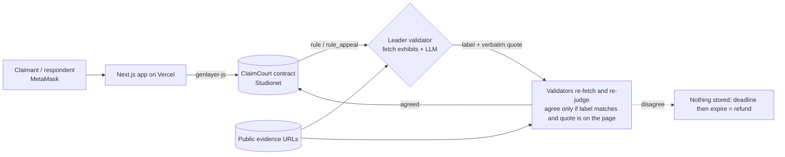

# ClaimCourt

**A mini on-chain court on GenLayer.** Two parties in a dispute each stake the same number of points, file a statement
and up to three public evidence URLs, and GenLayer AI validators fetch the evidence, reach consensus on a ruling
(**claimant wins / respondent wins / inconclusive**), and store written reasoning plus a verbatim quoted snippet on-chain.
A party who did not prevail can appeal once, for a bond, under a stricter standard. Every stage has a deadline, so no case can hang.

- Network: GenLayer **Studionet** (chain ID 61999, RPC `https://studio.genlayer.com/api`, gasless)
- Live app: https://claimcourt-dikacreams-projects.vercel.app
- Contract: [`contracts/claimcourt.py`](contracts/claimcourt.py), deployed at `0x6f5597E5cA680444a2E5DfFD50807C1Beb045fA1` (previous address superseded, see [deployments/SUPERSEDED.md](deployments/SUPERSEDED.md))
- Frontend: Next.js 16 + Tailwind 4 + MetaMask, an "editorial paper docket" design (`frontend/`)
- Stakes are **points with no monetary value** (1,000 free starting points per wallet)

## Why GenLayer

The question is *"which side do these web pages support?"* That is judgment over unstructured text, which none of the usual tools can give:

- **Oracles (Chainlink, Pyth)** deliver numbers from pre-agreed feeds; a dispute has no feed.
- **A plain contract** cannot fetch or read a page (only count human votes, with their own bribery and liveness issues).
- **An admin or one AI API** means one party decides other people's stakes.

On GenLayer every validator fetches the exhibits itself and runs its own LLM. A ruling is accepted only if validators reproduce the same label
(`CLAIMANT` / `RESPONDENT` / `INCONCLUSIVE`) **and** the leader's verbatim quote really appears on the cited page (custom equivalence principle,
`gl.vm.run_nondet_unsafe`). Stakes, deadlines, URL rules and payouts remain plain deterministic contract code.

## Architecture



## How a case works

1. **File.** The claimant stakes points and files claim, relief, statement and 1–3 evidence URLs. Validators screen the filing and
   **dismiss frivolous or vague cases before any stake is taken**.
2. **Answer.** The named respondent matches the stake and files a statement and 1–3 URLs before `respond_by`. No answer, then `expire` voids the case and refunds the claimant.
3. **Rule.** Anyone calls `rule`. The leader and validators fetch every exhibit (or use the stored snapshot) and each independently produces
   **structured findings** (at most 4: exhibit index, a verbatim quote, a one-sentence fact, and a `supports` label). A directional ruling must name a decisive finding
   that supports the ruled side; validators re-derive the findings and must agree on the label, on the decisive finding's support and on the quote being on the cited page. Anything else is `INCONCLUSIVE`.
4. **Appeal.** The non-prevailing party may appeal within the window for a **100-point bond** (plus one optional new exhibit). `rule_appeal` runs a **stricter second round** over *every* admitted exhibit
   (exact normalised-URL membership; overlapping paths are different exhibits). Exhibits are **snapshotted** when filed, answered or added: sha256 plus the **full fingerprinted 12,000-character window** (truncation is flagged);
   a page that changed since is judged from the stored text. If the stored history is incomplete, directional rulings are blocked.
5. **Settle.** Winner takes both stakes; inconclusive returns each stake. `finalize` after the appeal window.
6. **Timeouts and appeal finality.** A missing answer or ruling voids the case and refunds. **An appeal that is not completed never voids a valid first ruling**:

| Situation | Result |
|---|---|
| Appeal decided (upheld / overturned) | Final ruling; bond returned if overturned, forfeited to the prevailing party if upheld (returned if INCONCLUSIVE twice) |
| Appeal round ended with an objective consensus **UNDETERMINED** marker (network or fetch failure) | Not the appellant's fault: first ruling stands, bond returned, round can be retried |
| Appellant called `register_appeal_attempt` but no round completed | First ruling stands, bond split 50/50 (grace of 600 s added to the deadline, max 3 attempts) |
| Nobody pursued the appeal before the deadline | First ruling stands (`appeal_result = UNRESOLVED`), bond forfeited, so neither loser can escape risk-free |

Anyone can call `expire` to apply these rules after the deadline. There is no `APPEAL_TIMEOUT` void any more.

| Method | Who | Purpose |
|---|---|---|
| `claim_points()` | anyone | 1,000 starting points, once |
| `file_case(title, claim, relief, category, respondent, statement, urls, stake, respond_s, ruling_timeout_s, appeal_window_s, appeal_timeout_s)` | claimant | file and escrow |
| `withdraw_case(id)` | claimant | cancel an unanswered case |
| `respond(id, statement, urls)` | respondent | match stake, answer |
| `rule(id)` / `rule_appeal(id)` | anyone | AI ruling / stricter appeal ruling |
| `appeal(id, reason, extra_url)` | non-prevailing party | bond + grounds |
| `register_appeal_attempt(id)` | appellant | record a pursued attempt (grace, 50% bond refund if no round completes) |
| `finalize(id)` / `expire(id)` | anyone | settle after window / refund after deadline |
| views | | `get_case`, `get_cases(status, offset, limit)` (indexed, bounded, newest first), `get_cases_by_filer`, `get_user_cases`, `get_evidence`, `get_snapshots`, `get_user`, `get_stats`, `get_config` |

## Trust model

Full document: **[docs/TRUST_MODEL.md](docs/TRUST_MODEL.md)**. Summary:

- **Sources.** Only the text of the submitted evidence URLs, fetched by each validator itself. Statements are allegations. URLs are
  validated on-chain (https only, public domains, no shorteners/IPs). There is no admin, owner, or off-chain oracle key.
- **Integrity vs authenticity.** ClaimCourt guarantees *source-content integrity* (what each URL served is fingerprinted and judged as stored). It does **not** prove the *real-world authenticity* of that content: a page can be fabricated at the source. See [docs/TRUST_MODEL.md](docs/TRUST_MODEL.md) and the in-app `/trust` page.
- **Outcome agreement.** Custom equivalence principle (`gl.vm.run_nondet_unsafe`): the leader proposes structured findings and a ruling; each validator re-derives the findings from the same text and agrees only if the **ruling label, the decisive finding's support and the verbatim quote on the cited page** all hold. Free-text reasoning is not compared. Anything without a verifiable decisive quote is `INCONCLUSIVE`, which refunds both sides, so doubt never moves value.
- **Disagreement.** No majority means no ruling is stored; the ruling deadline then lets anyone `expire` the case and refund both stakes.
- **Challenge.** One bonded, stricter appeal (change the ruling only on clear and convincing evidence with a verbatim quote). Wrong appellants lose the bond (except inconclusive-on-inconclusive, refunded); an unpursued appeal never voids the first ruling (see the finality table). All party text, appeal grounds and the first ruling's quote/reasoning are fenced as untrusted data.
- **Attack scenarios** (prompt injection, evidence swapping, ruling-time manipulation, sybil, collusion, stalling) are tabulated with mitigations and gaps in section 5b of the trust model.
- **Residual risks** (snapshot limits and unstable pages, model error, prompt injection that fencing reduces but cannot remove, colluding wallets, testnet validators) are listed honestly in the trust model, with what is now fixed versus still open.

## Development

```bash
pip install -r requirements.txt
genvm-lint check contracts/claimcourt.py     # lint + validation
pytest tests/direct/ -v                       # direct-mode tests, web + LLM mocked

npm install
cp .env.example .env                          # add PRIVATE_KEY (and PRIVATE_KEY_2 for e2e); never commit it
npm run deploy:studionet                      # writes deployments/studionet.json + frontend/.env.local
node scripts/e2e-v2.mjs <upheld|overturn|inconclusive|uncompleted|registered|overlap|concurrent>
node scripts/e2e-changed.mjs file             # then edit docs/evidence/switch/respondent-note.txt on main, then: rule
node scripts/verify-deployment.mjs --write    # deployed-source fingerprint vs the repo source
node scripts/browser-demo.mjs                 # browser-originated demo against the live site

cd frontend && npm install && npm run dev     # NEXT_PUBLIC_CONTRACT_ADDRESS in frontend/.env.local
```

### Deployed-source verification

`scripts/verify-deployment.mjs` downloads the code that Studionet holds for the contract address (`getContractCode`), computes its sha256 and compares it with `contracts/claimcourt.py` and with the file on GitHub `main`.
The result (address, sha256, git commit, match) is recorded in [`deployments/verification.json`](deployments/verification.json).

### On-chain results

Every scenario writes `deployments/e2e-v2-<scenario>.json` with the tx hash and explorer link (`https://explorer-studio.genlayer.com/transactions/<tx>`) of each step, the observed outcome and the FINALIZED confirmation.
`deployments/browser-demo.json` records the browser-originated run. A summary is in [`deployments/RESULTS.md`](deployments/RESULTS.md).

## License

MIT
