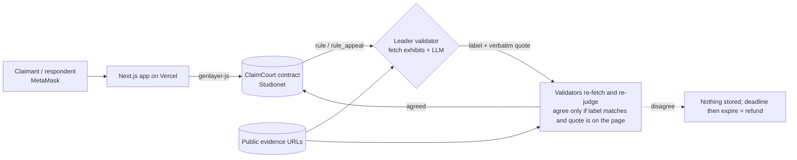

# ClaimCourt

**A mini on-chain court on GenLayer.** Two parties in a dispute each stake the same number of points, file a statement
and up to three public evidence URLs, and GenLayer AI validators fetch the evidence, reach consensus on a ruling
(**claimant wins / respondent wins / inconclusive**), and store written reasoning plus a verbatim quoted snippet on-chain.
A party who did not prevail can appeal once, for a bond, under a stricter standard. Every stage has a deadline, so no case can hang.

- Network: GenLayer **Studionet** (chain ID 61999, RPC `https://studio.genlayer.com/api`, gasless)
- Live app: https://claimcourt-dikacreams-projects.vercel.app
- Contract: [`contracts/claimcourt.py`](contracts/claimcourt.py), deployed at `0x72A5063875Bb25f8CF450eFe3710671de5bEF0aE`
- Frontend: Next.js 16 + Tailwind 4 + MetaMask, an "editorial paper docket" design (`frontend/`)
- Stakes are **points with no monetary value** (1,000 free starting points per wallet)

## Why GenLayer

The question is *"which side do these web pages support?"* That is judgment over unstructured text, which none of the usual tools can give:

- **Oracles (Chainlink, Pyth)** deliver numbers from pre-agreed feeds; a dispute has no feed.
- **A plain contract** cannot fetch or read a page (only count human votes, with their own bribery and liveness issues).
- **An admin or one AI API** means one party decides other people's stakes.

On GenLayer every validator fetches the exhibits itself and runs its own LLM. A ruling is accepted only if validators reproduce the same label
(`CLAIMANT` / `RESPONDENT` / `INCONCLUSIVE`) **and** the leader's verbatim quote really appears on the cited page (custom equivalence principle,
`gl.vm.run_nondet_unsafe`). Stakes, deadlines, URL rules and payouts remain plain deterministic contract code.

## Architecture



## How a case works

1. **File.** The claimant stakes points and files claim, relief, statement and 1–3 evidence URLs. Validators screen the filing and
   **dismiss frivolous or vague cases before any stake is taken**.
2. **Answer.** The named respondent matches the stake and files a statement and 1–3 URLs before `respond_by`. No answer, then `expire` voids the case and refunds the claimant.
3. **Rule.** Anyone calls `rule`. The leader and validators fetch every exhibit; a ruling for either side must cite a **verbatim quote** that exists on a submitted page, otherwise it is `INCONCLUSIVE`.
4. **Appeal.** The non-prevailing party may appeal within the window for a **100-point bond** (plus one optional new exhibit). `rule_appeal` runs a **stricter second round**. A changed ruling returns the bond; an upheld ruling for a side **forfeits the bond to that party** (if the first ruling was INCONCLUSIVE and stays so, the bond is returned). Exhibits are **snapshotted** (sha256 + 2,000-char excerpt, by validator consensus) when filed, answered or added on appeal; at ruling time a page that no longer matches its hash is judged from the stored excerpt and flagged.
5. **Settle.** Winner takes both stakes; inconclusive returns each stake. `finalize` after the appeal window.
6. **Timeouts.** No answer, no ruling, or no appeal decision before the deadline: `expire` (callable by anyone) voids the case and refunds stakes (and the bond).

| Method | Who | Purpose |
|---|---|---|
| `claim_points()` | anyone | 1,000 starting points, once |
| `file_case(title, claim, relief, category, respondent, statement, urls, stake, respond_s, ruling_timeout_s, appeal_window_s, appeal_timeout_s)` | claimant | file and escrow |
| `withdraw_case(id)` | claimant | cancel an unanswered case |
| `respond(id, statement, urls)` | respondent | match stake, answer |
| `rule(id)` / `rule_appeal(id)` | anyone | AI ruling / stricter appeal ruling |
| `appeal(id, reason, extra_url)` | non-prevailing party | bond + grounds |
| `finalize(id)` / `expire(id)` | anyone | settle after window / refund after deadline |
| views | | `get_case`, `get_cases`, `get_evidence`, `get_user`, `get_stats`, `get_config` |

## Trust model

Full document: **[docs/TRUST_MODEL.md](docs/TRUST_MODEL.md)**. Summary:

- **Sources.** Only the text of the submitted evidence URLs, fetched by each validator itself. Statements are allegations. URLs are
  validated on-chain (https only, public domains, no shorteners/IPs). There is no admin, owner, or off-chain oracle key.
- **Outcome agreement.** Custom equivalence principle (`gl.vm.run_nondet_unsafe`): the leader proposes a ruling; each validator re-fetches the cited page,
  checks the quoted sentence **literally appears there**, re-runs the judgment itself and agrees only if the **ruling label matches**. Free-text reasoning is not compared.
  Anything without a verifiable quote is downgraded to `INCONCLUSIVE`, which refunds both sides, so doubt never moves value.
- **Disagreement.** No majority means no ruling is stored; the ruling deadline then lets anyone `expire` the case and refund both stakes.
- **Challenge.** One bonded, stricter appeal (change the ruling only on clear and convincing evidence with a verbatim quote). Wrong appellants lose the bond (except inconclusive-on-inconclusive, refunded). All party text, appeal grounds and the first ruling's quote/reasoning are fenced as untrusted data.
- **Attack scenarios** (prompt injection, evidence swapping, ruling-time manipulation, sybil, collusion, stalling) are tabulated with mitigations and gaps in section 5b of the trust model.
- **Residual risks** (snapshot limits and unstable pages, model error, prompt injection that fencing reduces but cannot remove, colluding wallets, testnet validators) are listed honestly in the trust model, with what is now fixed versus still open.

## Development

```bash
pip install -r requirements.txt
genvm-lint check contracts/claimcourt.py     # lint + validation
pytest tests/direct/ -v                       # 27 direct-mode tests, web + LLM mocked

npm install
cp .env.example .env                          # add PRIVATE_KEY (and PRIVATE_KEY_2 for e2e); never commit it
npm run deploy:studionet                      # writes deployments/studionet.json + frontend/.env.local
npm run e2e:studionet                         # real on-chain run; writes deployments/e2e-studionet.json

cd frontend && npm install && npm run dev     # NEXT_PUBLIC_CONTRACT_ADDRESS in frontend/.env.local
```

The e2e script exercises on Studionet with two wallets: frivolous filing rejected, file → respond → rule → appeal → settle,
file → respond → rule → finalize, no-response timeout, ruling timeout, and appeal timeout, then checks points conservation. `npm run e2e:overturn` (appeal flips the ruling) and `node scripts/e2e-changed.mjs file|rule` (an exhibit edited after the snapshot) cover the other two scenarios.

## License

MIT
